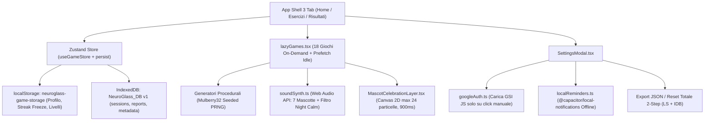
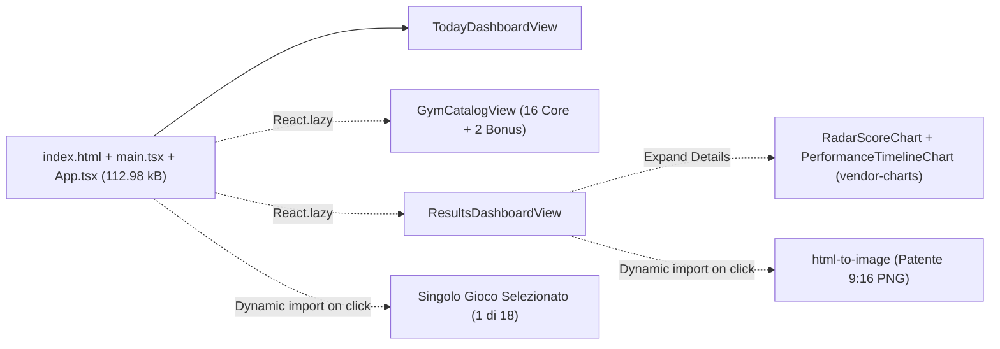

# NeuroGlass / AllenaMente — Guida Tecnica, Funzionale e Roadmap Completa

> **Versione Documentazione:** Novembre 2026 (Commit base `ba724e3` — Fasi 1–6 completate)  
> **Piattaforme:** Web App / PWA Responsive Mobile-First & App Android Nativa Offline (Capacitor)  
> **Posizionamento:** App di benessere cognitivo e intrattenimento ludico **100% Offline-First**, senza tracker pubblicitari e senza claim medici o diagnostici.

---

## Indice dei Contenuti

1. [Panoramica del Progetto & Numeri Chiave](#1-panoramica-del-progetto--numeri-chiave)
2. [Tour Visivo dell'Applicazione (Screenshot Reali)](#2-tour-visivo-dellapplicazione-screenshot-reali)
3. [Architettura Tecnica & Flusso Dati](#3-architettura-tecnica--flusso-dati)
4. [Come Funziona l'App: Motore Cognitivo, DDA, Audio e Duelli](#4-come-funziona-lapp-motore-cognitivo-dda-audio-e-duelli)
5. [Catalogo Completo dei 18 Giochi (16 Core + 2 Bonus Premium)](#5-catalogo-completo-dei-18-giochi-16-core--2-bonus-premium)
6. [Persistenza Locale, Privacy GDPR & Autenticazione Google OAuth 2.0](#6-persistenza-locale-privacy-gdpr--autenticazione-google-oauth-20)
7. [Ottimizzazioni Performance Già Applicate (Audit Fase 6)](#7-ottimizzazioni-performance-già-applicate-audit-fase-6)
8. [Diagnosi UX/UI & Roadmap di Miglioramento (DB, Sync, Giochi Viso)](#8-diagnosi-uxui--roadmap-di-miglioramento-db-sync-giochi-viso)
9. [Build, Suite di Test & Packaging Android APK/AAB](#9-build-suite-di-test--packaging-android-apkaab)

---

## 1. Panoramica del Progetto & Numeri Chiave

**AllenaMente / NeuroGlass** è un'applicazione per l'allenamento cognitivo quotidiano strutturata intorno a 4 pilastri fondamentali (**Logica**, **Memoria**, **Riflessi**, **Empatia/Neuroni Specchio**), progettata per funzionare completamente offline su browser mobile/desktop e come pacchetto nativo Android ultra-leggero.

### Metriche Tecniche Verificate (Stato Attuale)

| Indicatore | Valore Misurato | Riferimento / Note |
| :--- | :--- | :--- |
| **Giochi Totali** | **18 giochi** (16 Core + 2 Bonus Premium) | `src/constants/gamesData.ts` |
| **Livelli Procedurali** | **100 livelli per gioco** (1.800 configurazioni uniche) | Generatori deterministici `Mulberry32` |
| **Peso Bundle Startup** | **112.98 kB** (`index-*.js` post-ottimizzazione) | `-32%` rispetto ai `165.93 kB` pre-Fase 6 |
| **Peso APK Android** | **2.3 MB** (`2,402,900` byte) | `public/NeuroGlass-Allenamente.apk` |
| **Peso AAB Android** | **2.8 MB** | Release Play Store bundle |
| **Permessi Android** | Zero `INTERNET`, Zero `SCHEDULE_EXACT_ALARM` | Verificato con `aapt dump permissions` |
| **Suite Unit Test** | **54 / 54 passati** (8 file Vitest) | `npm test` |
| **Suite E2E Playwright** | **Verificata al 100%** (0 errori console/rete) | Offline, GDPR, Onboarding, Coach, Rotte |

---

## 2. Tour Visivo dell'Applicazione (Screenshot Reali)

Tutti gli screenshot seguenti sono stati acquisiti su build di produzione (`vite preview`) con viewport mobile `390×844` (`deviceScaleFactor: 2`).

### 2.1 Home Dashboard & Barra Fissa stile Telegram

La schermata principale concentra l'attenzione su un'unica card operativa (*Circuito Neurale del Giorno*), accompagnata dal badge di protezione **Ghiaccio della Serie (`1/1 protetto`)**, dal pill dello streak e dalla barra inferiore fissa a 3 sole tab (**Home**, **Esercizi**, **Risultati**) priva di sheet espandibili.


### 2.2 Catalogo Palestra Cognitiva (16 Core + 2 Extra Bonus Premium)

La tab **Esercizi** ospita la ricerca rapida, i filtri per i 4 pilastri cognitivi, il banner per l'Assessment delle 15 Matrici, la griglia dei **16 esercizi Core** e la nuova sezione dedicata **Extra Bonus • Anteprima Premium**.

| Catalogo 16 Giochi Core | Sezione Extra Bonus • Anteprima Premium |
| :---: | :---: |
|  |  |

### 2.3 I 2 Nuovi Giochi Bonus in Azione

- **Circuito Sinaptico (`neural-circuit`)**: puzzle spaziale-logico con validazione topologica BFS su griglie 3×3–5×5 per instradare l'impulso dalla sorgente ai recettori ruotando i nodi di 90°.
- **Bussola Empatica (`perspective-compass`)**: esercizio ispirato al *Director Task* per allenare il perspective-taking spaziale superando il bias egocentrico, con schermi opachi (*frosted occlusion shields*).

| Circuito Sinaptico (Logica) | Bussola Empatica (Empatia / TPJ) |
| :---: | :---: |
|  |  |

### 2.4 Scheda Risultati, Coach AI & Deep Dive

La tab **Risultati** separa la sintesi immediata (metriche essenziali + verdetto del Coach AI) dal pannello avanzato collassabile (*Radar a 4 Assi*, trend storico e generazione della Patente Neurale 9:16).

| Sintesi Risultati & Coach AI | Dettagli Avanzati (Radar & Bilanciamento) |
| :---: | :---: |
|  |  |

### 2.5 Impostazioni Centralizzate, Google Auth, Calibrazione & Giochi Emotivi

- **Impostazioni (`SettingsModal.tsx`)**: download diretto APK (`2.3 MB`), guida PWA offline, login opzionale con Account Google (`Client ID` configurabile), 4 temi visivi (*Neo-Brutalist Raw #25*, *Zen Garden Pebble #30*, *Warm Liquid Glass #01*, *Obsidian Dark #02*), anteprima audio delle 7 mascotte, promemoria offline, esportazione JSON e reset GDPR in 2 passaggi.
- **Calibrazione Iniziale (`InitialCalibrationModal.tsx`)**: 4 micro-sfide opzionali (~2 minuti) per popolare da subito il radar, con uscita libera verso la Home (*"Esplora subito la Home"*).
- **Sintonia Emotiva (`EmotionalResonanceGame.tsx`)**: micro-espressioni facciali e scenari relazionali (vedi Sezione 8 per l'analisi critica delle sfumature SVG).

| Impostazioni & Account Google | Calibrazione Iniziale (4 Micro-Sfide) | Sintonia Emotiva (Volto SVG / Flash) |
| :---: | :---: | :---: |
|  |  |  |

---

## 3. Architettura Tecnica & Flusso Dati

### 3.1 Stack Tecnologico

- **UI & Rendering:** React `18.3.1`, TypeScript, Tailwind CSS + CSS Custom Properties per i 4 temi (`src/index.css`).
- **Build & Code Splitting:** Vite `5.4.10` con caricamento lazy (`React.lazy` + `Suspense`) per viste secondarie (`ResultsDashboardView`, `GymCatalogView`), modali (`SettingsModal`, `InitialCalibrationModal`, `NeuralProfileModal`) e per tutti i **18 giochi** (`src/components/games/lazyGames.tsx`).
- **State Management:** Zustand `5.0.1` (`src/store/useGameStore.ts`) con middleware `persist` su `localStorage` (`neuroglass-game-storage`) e selettori `useShallow` nei container principali.
- **Storage Storico & Offline:** `IndexedDB` (`NeuroGlass_DB` v1 in `src/engine/storage/db.ts`) per sessioni complete, report e metadati.
- **Grafici & Esportazione:** `Recharts 2.13.3` (caricato solo all'espansione dei dettagli in *Risultati*) + `html-to-image 1.11.13` (importato dinamicamente su click per la Patente Neurale 9:16).
- **Audio & Animazioni:** Framer Motion `11.11.17` (`motionTokens.ts`) + Web Audio API nativo (`soundSynth.ts`) + Canvas 2D (`MascotCelebrationLayer.tsx`).
- **Wrapper Nativo Android:** Capacitor con plugin `@capacitor/app` (tasto indietro fisico Android) e `@capacitor/local-notifications`.

### 3.2 Diagramma Architetturale del Flusso Offline-First



### 3.3 Pipeline di Code-Splitting & Moduli



### 3.4 Mappa dei Moduli Principali

| Percorso | Responsabilità |
| :--- | :--- |
| [src/App.tsx](file:///home/chris/ALLENAMENTE/src/App.tsx) | Shell principale a 3 tab, onboarding/calibrazione lazy, listener `backButton` Capacitor stabile, gestione deep-link `?duel=1`. |
| [src/store/useGameStore.ts](file:///home/chris/ALLENAMENTE/src/store/useGameStore.ts) | Stato globale persistito: profilo, streak & Streak Freeze mensile, sblocco livelli sui 18 giochi, temi, promemoria, azioni Google OAuth e reset GDPR. |
| [src/engine/storage/db.ts](file:///home/chris/ALLENAMENTE/src/engine/storage/db.ts) | Wrapper `NeuroStorage` per `IndexedDB` (`sessions`, `reports`, `metadata`), cache in memoria `cachedProgress` e `INITIAL_UNLOCKED_LEVELS`. |
| [src/constants/gamesData.ts](file:///home/chris/ALLENAMENTE/src/constants/gamesData.ts) | Metadati dei 18 giochi (`id`, pilastro, micro-tutorial, tag neuro-anatomico, flag `isBonus` / `isPremium`). |
| [src/components/games/lazyGames.tsx](file:///home/chris/ALLENAMENTE/src/components/games/lazyGames.tsx) | Mappa `GAME_IMPORTERS`, esportazioni `Lazy*` e prefetch intelligente `prefetchWorkoutGames` a browser idle. |
| [src/components/games/GameModal.tsx](file:///home/chris/ALLENAMENTE/src/components/games/GameModal.tsx) | Contenitore universale di gioco: wake lock, auto-pausa su tab nascosta, micro-tutorial + countdown 3-2-1, DDA e celebrazione mascotte. |
| [src/engine/auth/googleAuth.ts](file:///home/chris/ALLENAMENTE/src/engine/auth/googleAuth.ts) | Caricamento dinamico on-click di Google Identity Services (`accounts.google.com/gsi/client`), decoding JWT e detection Capacitor. |
| [src/engine/audio/soundSynth.ts](file:///home/chris/ALLENAMENTE/src/engine/audio/soundSynth.ts) | Sintesi Web Audio API a zero asset esterni: feedback UI, 7 profili sonori mascotte, filtro passa-basso *Night Calm -3dB* in Obsidian. |

---

## 4. Come Funziona l'App: Motore Cognitivo, DDA, Audio e Duelli

### 4.1 Flusso Utente Giornaliero & Calibrazione Iniziale
1. **Primo Avvio & Consenso (`AgeCohortOnboardingModal`):** l'utente seleziona la fascia anagrafica (`14-24` ... `65+`) e accetta i termini non-clinici locali.
2. **Calibrazione Iniziale (`InitialCalibrationModal`):** card di scelta non invasiva con opzione rapida *"Esplora subito la Home"* oppure *"Calibra il tuo Profilo (4 micro-sfide • ~2 min)"* che esegue 1 micro-prova per pilastro (Logica: 2 matrici; Memoria: 1 sequenza Matrice di Luce; Riflessi: 4 stimoli Freno Rapido; Empatia: 2 micro-sguardi) e popola il Radar iniziale + Indice di Velocità (pt).
3. **Circuito Neurale del Giorno (`DailyWorkoutModal`):** sequenza guidata in 4 stadi (uno per pilastro), completabile in ~3 minuti per chiudere i 4 anelli quotidiani.
4. **Palestra Libera (`GymCatalogView`):** accesso diretto a tutti i 18 giochi con selettore di livello (1–100) e filtri per pilastro.

### 4.2 Generazione Procedurale & Adattamento Dinamico (DDA)
- Ogni generatore in `src/engine/procedural/` accetta un livello `1..100` (e ove previsto un `seed` deterministico Mulberry32) costruendo i livelli algoritmicamente a zero payload immagini/JSON statici.
- `GameModal.tsx` calcola `calculateEffectiveLevel` per adattare la difficoltà effettiva in base al rendimento recente senza bloccare la progressione positiva dell'utente.

### 4.3 Ghiaccio della Serie (Streak Freeze Automatico 1/Mese)
Implementato in `useGameStore.ts` e visualizzato nella Home (`TodayDashboardView.tsx`):
- Lo stato persiste `streakFreezesAvailable` (default `1`), `lastFreezeUsedDate` (`YYYY-MM-DD`) e `lastFreezeRefillMonth` (`YYYY-MM`).
- **Ricarica automatica:** al cambio di mese solare (`YYYY-MM`), `streakFreezesAvailable` si ricarica automaticamente a `1`.
- **Protezione a mezzanotte:** se la distanza dal `lastWorkoutDate` è esattamente **2 giorni** (1 solo giorno intero saltato) e `streakFreezesAvailable > 0`, il sistema consuma il cristallo e **preserva lo streak**, mostrando un banner morbido di avviso. A 3+ giorni di distanza (2+ giorni saltati), lo streak riparte.

### 4.4 Mascotte, Sintesi Audio Web Audio & Canvas 60fps
- **7 Profili Sonori Unici (`soundSynth.ts`):** zero file MP3/WAV; ogni mascotte (*Panda*, *Volpe*, *Gufo*, *Lontra*, *Gatto*, *Cervo*, *Lupo* / varianti configurate) attiva una firma armonica distinta (es. campana zen pentatonica per Panda, arpeggio rapido per Volpe, accordo cristallino per Gufo), con disconnessione esplicita dei nodi AudioContext al termine e filtro passa-basso *Night Calm (-3dB)* in tema Obsidian Dark.
- **Particelle Canvas (`MascotCelebrationLayer.tsx`):** un singolo `<canvas>` temporaneo `pointer-events-none` (durata `900ms`, max **24** particelle geometriche vettoriali, zero emoji Unicode) che si smonta al termine.

### 4.5 Duello 1vs1 Split-Screen & Promemoria Offline
- **Duelli Remoti (`duelShareEngine.ts`, `DuelChallengeLandingModal.tsx`, `DuelComparisonModal.tsx`):** i link sfida (`?duel=1&...`) condividono lo stesso `seed` Mulberry32 su Web Share API / WhatsApp. Al termine della sfida appare la scheda **Tu vs Amico** con barre su Punteggio, Tempo di Reazione (delta esatto in `ms`) e Accuratezza (`%`), più il tasto **Lancia Rivincita (Nuovo Schema)**.
- **Promemoria Locale Quotidiano (`localReminders.ts`):** usa la pianificazione ricorrente standard (`repeats: true`, `allowWhileIdle: false`) senza `SCHEDULE_EXACT_ALARM`, chiedendo il permesso notifiche esclusivamente all'attivazione del toggle nelle Impostazioni.

---

## 5. Catalogo Completo dei 18 Giochi (16 Core + 2 Bonus Premium)

### 5.1 Core Suite (16 Giochi Principali)

| ID (`GameId`) | Titolo | Pilastro | Meccanica & Focus |
| :--- | :--- | :--- | :--- |
| `raven-matrix` | Matrici Astratte | Logica (`logic`) | Completamento pattern visuo-geometrici 3×3 (ragionamento fluido) |
| `abstract-sequences` | Sequenze Nascoste | Logica (`logic`) | Induzione regole logiche su successioni simboliche/visive |
| `pattern-folding` | Piegamento 3D | Logica (`logic`) | Rotazione mentale e folding spaziale di reti piane |
| `subitizing` | Colpo d'Occhio | Logica (`logic`) | Stima visiva istantanea della numerosità senza conteggio lineare |
| `light-matrix` | Costellazione di Luce | Memoria (`memory`) | Memoria visuo-spaziale a breve termine su griglie luminose |
| `n-back` | Doppia Traccia | Memoria (`memory`) | Aggiornamento continuo della memoria di lavoro (*Dual/N-Back*) |
| `digit-span` | Eco di Numeri | Memoria (`memory`) | Ritenzione sequenziale diretta e inversa di stringhe numeriche |
| `hippocampus-maze` | Labirinto Mentale | Memoria (`memory`) | Navigazione allocentrica e mappa mentale spaziale |
| `impulse-inhibition` | Freno Rapido | Riflessi (`reflex`) | Paradigma Go / No-Go per controllo inibitorio della risposta |
| `dynamic-stroop` | Filtro Colore | Riflessi (`reflex`) | Gestione dell'interferenza cognitiva colore-parola ad alta velocità |
| `multi-tracking` | Tracciamento Multiplo | Riflessi (`reflex`) | *Multiple Object Tracking (MOT)* e attenzione divisa |
| `trail-making` | Sentiero Fluido | Riflessi (`reflex`) | Flessibilità attentiva e switching rapido visuo-motorio |
| `kinetic-mirror` | Specchio Visuo-Motorio | Empatia (`mirror`) | Coordinazione speculare ed elaborazione visuo-motoria |
| `emotional-resonance` | Sintonia Emotiva | Empatia (`mirror`) | Decodifica flash micro-espressioni e scenari relazionali |
| `rhythm-mirror` | Sincronia Ritmica | Empatia (`mirror`) | Riproduzione precisa di pattern temporali e sincronia |
| `mind-eyes` | Oltre lo Sguardo | Empatia (`mirror`) | Lettura degli stati mentali dalla regione oculare (*RMET-inspired*) |

### 5.2 Extra Bonus • Anteprima Premium (2 Nuovi Giochi)

1. **`neural-circuit` — Circuito Sinaptico** ([circuitGenerator.ts](file:///home/chris/ALLENAMENTE/src/engine/procedural/circuitGenerator.ts), [NeuralCircuitGame.tsx](file:///home/chris/ALLENAMENTE/src/components/games/logic/NeuralCircuitGame.tsx))  
   - **Pilastro:** Logica / Pianificazione esecutiva (`DLPFC`).  
   - **Meccanica:** griglie procedurali `3×3` → `5×5` con sorgente iniziale, conduttori ruotabili di `90°` (`I`, `L`, `T`, `X`), nodi bloccati ai livelli alti e 1–3 recettori target. Ogni livello è garantito risolvibile perché il generatore costruisce prima l'albero di copertura valido e verifica in tempo reale la propagazione elettrica tramite algoritmo **BFS (Breadth-First Search)**, confrontando le mosse effettuate con il valore `parMoves`.
2. **`perspective-compass` — Bussola Empatica** ([perspectiveGenerator.ts](file:///home/chris/ALLENAMENTE/src/engine/procedural/perspectiveGenerator.ts), [PerspectiveCompassGame.tsx](file:///home/chris/ALLENAMENTE/src/components/games/mirror/PerspectiveCompassGame.tsx))  
   - **Pilastro:** Empatia & Teoria della Mente (`Giunzione TPJ`).  
   - **Meccanica:** adattamento gamificato del *Director Task*. Una griglia `3×3` contiene icone geometriche posizionate davanti a un soggetto orientato (`N / E / S / O`). Alcune celle hanno un pannello opaco (*frosted occlusion shield*): il giocatore deve ignorare gli oggetti nascosti alla vista del soggetto e tradurre le istruzioni (*"più a DESTRA/SINISTRA/VICINO/LONTANO dal mio punto di vista"*) tramite `toDirectorCoords` per superare il bias egocentrico entro il timeout di turno.

---

## 6. Persistenza Locale, Privacy GDPR & Autenticazione Google OAuth 2.0

### 6.1 Architettura Locale a Zero-Network
Per soddisfare i test offline (`test_commit6b_offline_network`) e la privacy su Android senza permesso `INTERNET`:
- **Zustand `persist` (`localStorage`):** salva configurazione, profilo, `unlockedLevels`, streak, *Ghiaccio della Serie*, preferenze tema/audio e configurazione promemoria.
- **`IndexedDB` (`NeuroGlass_DB` v1):** memorizza le singole sessioni di allenamento (`sessions`), un unico snapshot report aggiornato in overwrite (`reports`) per evitare crescita incontrollata su disco, più una cache RAM `cachedProgress` per evitare aperture ridondanti del cursore IDB ad ogni lettura.
- **Compliance GDPR (`Export` & `Delete`):** il pulsante di esportazione produce un JSON completo di tutti i rami salvati; il reset totale in 2 step (`handleResetData`) ripulisce sia `localStorage` sia i 3 object store di `IndexedDB` (inclusi calibrazione, streak freeze, preferenze notifiche e sessione Google locale).

### 6.2 Autenticazione Google OAuth 2.0 On-Demand (`googleAuth.ts`)
- **Zero chiamate al boot:** nessuno script Google viene incluso in `index.html` o eseguito all'avvio.
- **Caricamento esclusivamente su azione esplicita:** solo quando l'utente clicca **"Accedi con Google"** in `SettingsModal.tsx` (o dal profilo), `loadGoogleIdentityScript()` inietta `https://accounts.google.com/gsi/client`, avvia il prompt Google Identity Services e decodifica localmente il token JWT (`parseGoogleJwt`) per salvare nome, email, avatar Google (`profile.picture`) e `googleSub`.
- **Vincolo Capacitor Android:** nell'APK Android compilato *senza* permesso `INTERNET` (`AndroidManifest.xml`), la WebView non effettua traffico verso GSI; il modulo rileva l'ambiente tramite `isNativeCapacitorShell()` e mostra una spiegazione chiara all'utente invece di fallire silenziosamente.

---

## 7. Ottimizzazioni Performance Già Applicate (Audit Fase 6)

Prima di generare questa guida sono stati risolti tutti i principali colli di bottiglia rilevati dall'audit tecnico (commit `ba724e3`):

1. **Bundle Startup Ridotto del 32%:** `ResultsDashboardView` (inclusi `RadarScoreChart` e `PerformanceTimelineChart` basati su Recharts) è ora lazy-loaded e separato dal chunk iniziale (`112.98 kB` vs `165.93 kB`), con `html-to-image` importato dinamicamente solo quando si esporta la Patente Neurale 9:16.
2. **Taglio ai Re-Render Globali:** conversione delle sottoscrizioni intere `useGameStore()` in selettori atomici / `useShallow` nei container principali (`App.tsx`, `GameModal.tsx`, `SettingsModal.tsx`, `ResultsDashboardView.tsx`, `NeuralProfileModal.tsx`).
3. **Pulizia Listener, Timer e Animazioni:**
   - Rimozione `requestAnimationFrame` no-op in `ImpulseInhibitionGame.tsx` e aggiunta cleanup `cancelAnimationFrame` in `AnimatedScoreOdometer.tsx`.
   - Sostituzione della callback instabile in `MascotCelebrationLayer.tsx` con `onFinishedRef` (previene il riavvio dell'animazione Canvas ad ogni render padre) e rimozione dei confetti duplicati in `GameModal.tsx`.
   - Cleanup esplicito dei timer pendenti su unmount in `RhythmMirrorGame.tsx`, `DynamicStroopGame.tsx` e `MultiTrackingGame.tsx`.
   - Rimozione del filtro SVG globale `feTurbulence` su `body::before` e di `will-change: transform` globale in `src/index.css` per ridurre drasticamente l'overdraw GPU sui dispositivi Android di fascia media.

---

## 8. Diagnosi UX/UI & Roadmap di Miglioramento (DB, Sync, Giochi Viso)

Questa sezione raccoglie i bug UX reali individuati ispezionando il codice e gli screenshot, insieme al piano evolutivo per Database, Autenticazione Cloud e qualità dei giochi.

### 8.1 Perché i Giochi sul Viso Risultano Frustranti (Diagnosi Dal Codice)

L'analisi diretta dei file [EmotionalResonanceGame.tsx](file:///home/chris/ALLENAMENTE/src/components/games/mirror/EmotionalResonanceGame.tsx), [mirrorGenerator.ts](file:///home/chris/ALLENAMENTE/src/engine/procedural/mirrorGenerator.ts), [MindEyesGame.tsx](file:///home/chris/ALLENAMENTE/src/components/games/mirror/MindEyesGame.tsx) e [mindEyesGenerator.ts](file:///home/chris/ALLENAMENTE/src/engine/procedural/mindEyesGenerator.ts) conferma esattamente perché distinguere le emozioni appaia troppo sottile per l'occhio umano:

1. **Valori generati ma mai renderizzati in `EmotionalResonanceGame.tsx`:**
   - `EMOTIONS_CATALOG` in `mirrorGenerator.ts` definisce attributi distintivi come `eyes: 'squint'` e `mouth: 'smirk'` (es. per emozioni sfumate come *Sospetto*, *Disprezzo* o *Sollievo*), ma il componente SVG `renderFaceSVG()` non implementa i relativi rami grafici per `'squint'` e `'smirk'`, ricadendo sugli occhi/bocca standard di default!
   - Di conseguenza, **due emozioni diverse finiscono per disegnare tratti facciali quasi identici** su un cerchio minimale (`viewBox="0 0 120 120"`), trasformando una prova di empatia in un tiro a indovinare dopo il flash rapido (`flashDurationMs`).
2. **Stessa lacuna in `MindEyesGame.tsx` (*Oltre lo Sguardo*):**
   - `EYES_STATES_CATALOG` (`mindEyesGenerator.ts`) specifica dettagli fini come `eyelids: { upperCoverage, curve: 'tense' | 'drooping' | ... }` e `eyebrows.arch === 'furrowed'`, ma `MindEyesGame.tsx` disegna 2 ellissi stilizzate senza renderizzare né la curvatura tensiva/cadente della palpebra (`eyelids.curve`), né il corrugamento delle sopracciglia (`furrowed`).

#### Come Renderli Piacevoli e Giusti (Proposta Tecnica)
- **Completezza SVG + Micro-Dettagli Espressivi:** implementare tutti i rami mancanti (`squint`, `smirk`, `furrowed`, `eyelids.curve` differenziata con piega superiore/inferiore), aggiungendo linee di tensione su fronte/zigomi, dimensione pupillare reale (`constricted` vs `dilated`) e contrasto netto del contorno.
- **Modalità Didattica / "Feedback Visivo Post-Risposta":** dopo il tap (corretto o errato), congelare il volto per `1.5s` evidenziando visivamente i 2 indizi chiave (*"Sopracciglia asimmetriche + mezzo sorriso tirato = Scetticismo"*), così l'utente impara e non si sente punito alla cieca.
- **Timing Calibrato sul Livello:** aumentare la finestra di esposizione iniziale nei primi 15 livelli (es. da `1.8s` a `2.8s`) invece di nascondere il volto troppo presto prima che l'occhio metta a fuoco.

### 8.2 Altre Piccole Inconsistenze Visive Rilevate negli Screenshot
- **Contrasto titolo in `InitialCalibrationModal.tsx`:** nello screenshot `09_calibrazione_iniziale.png`, il titolo scuro *"Calibrazione Iniziale"* appoggia su un pannello glass scuro rendendo la leggibilità bassa. Va forzato `text-white` o sfondo chiaro ad alto contrasto coerente con il tema attivo.
- **Copy legacy residuo in `NeuralProfileModal.tsx`:** nel modale profilo è ancora presente la stringa interna `"Età Neurale Stimata"` invece del posizionamento ludico consolidato (*"Profilo Cognitivo Ludico"* / *"Indice di Velocità (pt)"*).

### 8.3 Roadmap Evoluzione Database, Google Sync & Giochi Premium

| Area | Stato Attuale (v1.2 Offline) | Evoluzione Consigliata (Fase 7–8) |
| :--- | :--- | :--- |
| **Database Interno Locale** | Zustand `localStorage` + `IndexedDB` (`sessions`, `reports` singolo, `metadata`) | Migrazione a schema normalizzato con storico aggregato giornaliero (`daily_stats`), indice per `gameId + date` e compattazione automatica delle sessioni > 90 giorni. |
| **Database Esterno & Cloud Sync** | Assente (100% locale) | **Supabase (Postgres + RLS)** oppure **Firebase Firestore** con pattern *Offline-First Outbox Queue*: i giochi continuano a funzionare offline e sincronizzano i delta solo se l'utente attiva volontariamente la sincronizzazione Cloud. |
| **Autenticazione Google** | Web GSI OAuth on-click (solo profilo locale) | Abilitazione opt-in di **`INTERNET`** (su una variante Cloud dell'APK) + plugin nativo Android **Credential Manager / Google Sign-In**, mappando il `googleSub` alle tabelle utente cloud tramite JWT verificato lato server. |
| **Giochi Piacevoli ("Calm Arcade")** | Alcuni giochi molto dipendenti dal cronometro (pressione temporale) | Aggiungere modalità **"Flusso Zen" senza timer** su puzzle spaziali (`Circuito Sinaptico`, `Piegamento 3D`), più pacchetti sbloccabili di puzzle logici ed emotivi ad alta gratificazione visiva. |

---

## 9. Build, Suite di Test & Packaging Android APK/AAB

Tutti i comandi vanno eseguiti dalla root `/home/chris/ALLENAMENTE`:

```bash
# 1. Sviluppo locale
npm run dev

# 2. Suite Unit Test (Vitest - 54/54 test su logica cognitiva, scoring, streak freeze, duelli, bonus games & auth)
npm test

# 3. Build produzione Web & PWA
npm run build

# 4. Anteprima produzione (servita anche su tunnel Cloudflare)
npm run preview -- --host 0.0.0.0 --port 4173

# 5. Verifica E2E Playwright (offline/rete zero, GDPR, onboarding, rotte legali)
node tests/test_commit6b_offline_network.mjs
node tests/test_commit7c_terms_onboarding.mjs
node tests/test_commit7d_export_delete.mjs

# 6. Sync & Compilazione Android Release (APK + AAB)
npx cap sync android
cd android && ./gradlew assembleRelease bundleRelease
```

### Checklist Sicurezza & Play Store già Verificata
- **Permessi APK (`aapt dump permissions`):** nessun `android.permission.INTERNET` e nessun `android.permission.SCHEDULE_EXACT_ALARM` presenti nel manifest compilato.
- **Impatto Packaging:** gli asset di documentazione (`ALLENAMENTE_MASTER_GUIDE.md`, `docs/screens/*.png`, `AllenaMente-Guida-Completa.zip`, `AllenaMente-src.zip`) sono serviti in `dist/` per il download diretto **senza** essere copiati in `public/`, preservando la soglia `< 3 MB` dell'APK Android (`2.3 MB` effettivi).
